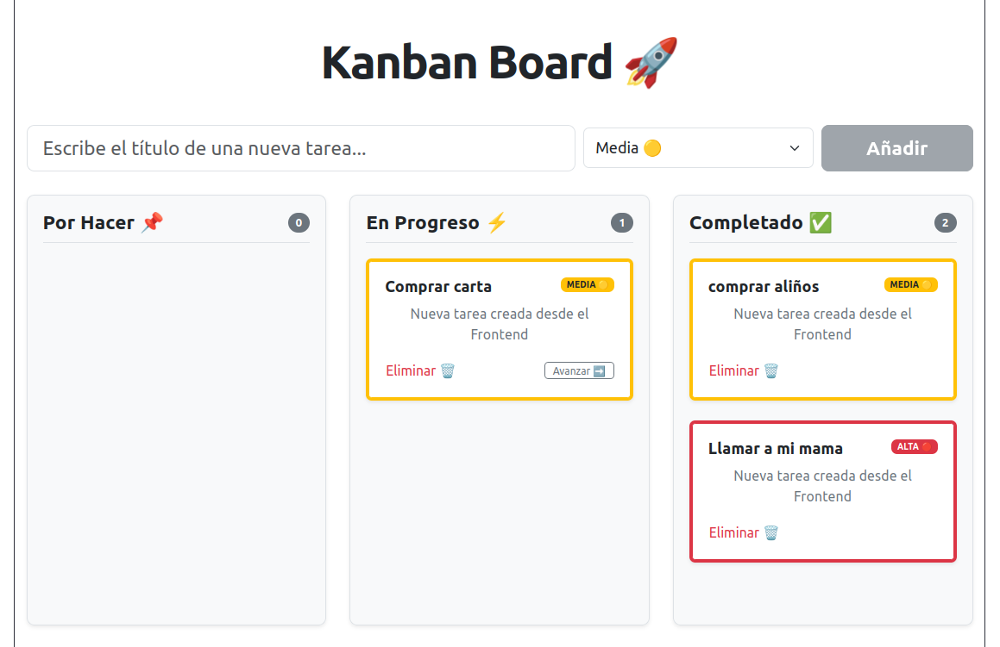

# Kanban Task Manager 🚀

[](https://github.com/ycsa91/kanban-task-manager/actions/workflows/ci-cd.yml)

Un tablero Kanban interactivo y profesional con arquitectura desacoplada (Full-Stack), contenedorizado con **Docker** y automatizado mediante un pipeline de **CI/CD en GitHub Actions**. El proyecto cuenta con un backend robusto para la persistencia de datos y un frontend dinámico que implementa las mejores prácticas del ecosistema moderno.



## 🛠️ Stack Tecnológico

### Frontend
- **React 19 & Vite** como entorno de desarrollo ágil.
- **TypeScript** con tipado estricto (`verbatimModuleSyntax`).
- **Bootstrap 5** para un diseño visual moderno, responsivo y limpio.
- **Axios** para la gestión de peticiones HTTP de forma centralizada.
- **Oxlint** para análisis estático ultrarrápido del código.

### Backend & Base de Datos
- **Laravel 12 (PHP 8.2)** encargado de exponer una API RESTful estructurada.
- **MySQL 8.0** como motor de base de datos relacional para la persistencia real.
- **PHPUnit** para pruebas automatizadas.

### DevOps (Docker & CI/CD)
- **Docker & Docker Compose:** Orquestación multi-contenedor (`mysql`, `laravel-api`, `react-nginx` con *Multi-stage builds*).
- **GitHub Actions (CI/CD):** Ejecución automática de tests (PHPUnit), linter (Oxlint), verificación de compilación TypeScript y publicación continua de imágenes en **GitHub Container Registry (GHCR)**.

---

## ✨ Características Principales (Features)
- **Persistencia en tiempo real:** Gestión completa de tareas conectada directamente a la base de datos (CRUD).
- **Control de Prioridades:** Renderizado dinámico de tarjetas (`Baja 🟢`, `Media 🟡`, `Alta 🔴`) con estilos visuales condicionales.
- **Drag and Drop Nativo:** Movimiento fluido de tarjetas entre columnas utilizando la API de HTML5.
- **Manejo de Estados de Carga (Loading States):** Bloqueo y atenuación visual de tarjetas individuales (*"Sincronizando..."*) durante las peticiones asíncronas para evitar colisiones de red.
- **Resiliencia ante Errores:** Control de excepciones del servidor con alertas interactivas para el usuario en caso de fallas de conexión.
- **Arquitectura Limpia:** Separación estricta de responsabilidades mediante componentes modulares reutilizables.
- **Seguridad en Configuración:** Gestión de variables de entorno mediante archivos `.env`.

---

## 🐳 Despliegue Rápido con Docker (Recomendado)

Puedes levantar todo el entorno (Base de Datos MySQL + API Laravel con migraciones automáticas + Frontend React en Nginx) con un solo comando sin necesidad de instalar PHP, Composer, Node.js ni MySQL en tu máquina:

```bash
docker compose up -d --build
```

Una vez iniciados los contenedores, accede a:
- **Frontend (Aplicación Web):** [http://localhost:8080](http://localhost:8080)
- **Backend (API REST):** [http://localhost:8000/api/tasks](http://localhost:8000/api/tasks)
- **MySQL (Puerto externo):** `localhost:3307`

Para detener los contenedores:
```bash
docker compose down
```

---

## 💻 Instalación Manual (Desarrollo Local sin Docker)

El proyecto está dividido en dos directorios independientes:

### 1. Configuración del Backend (`task-manager-api`)
```bash
cd task-manager-api
composer install
cp .env.example .env  # Configura tus credenciales de MySQL aquí
php artisan key:generate
php artisan migrate
php artisan serve
```

### 2. Configuración del Frontend (`task-manager-front`)
```bash
cd task-manager-front
npm install
```

Crea un archivo `.env.local` en la raíz de la carpeta del frontend y añade la URL de tu API:
```env
VITE_API_BASE_URL=http://127.0.0.1:8000/api
```

Finalmente, arranca el servidor de desarrollo:
```bash
npm run dev
```
